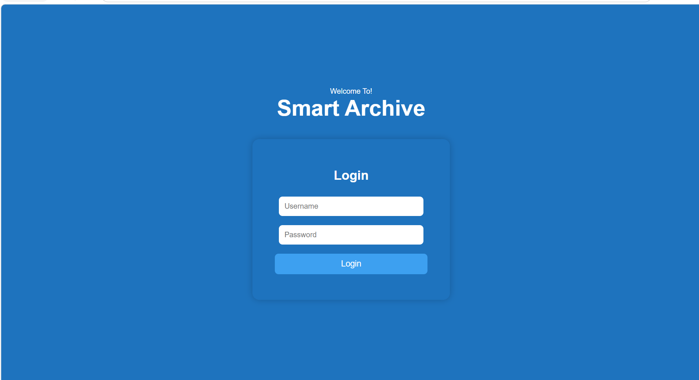
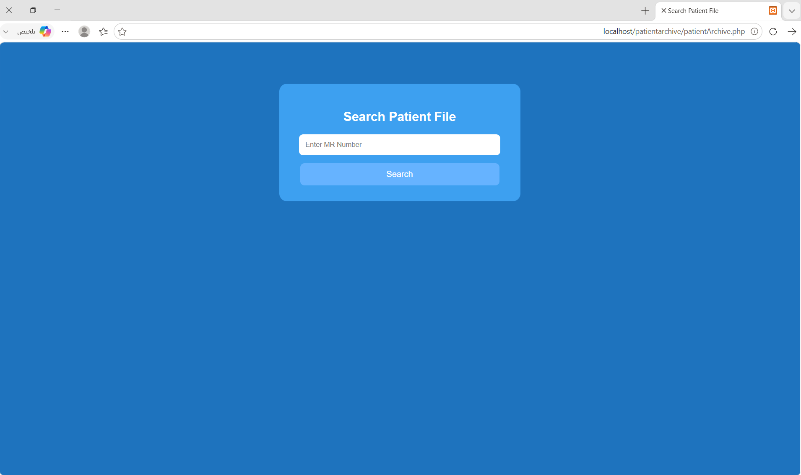
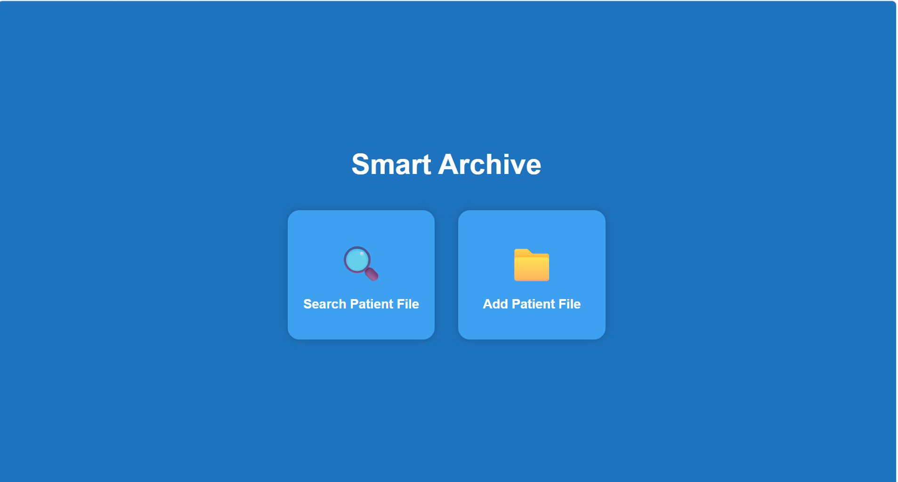

Smart Archive | Physical Medical Records Locator
A web application designed to help medical records staff organize and locate physical patient files within a hospital archive using each patient’s Medical Record Number (MR).
The system links each file to a specific storage location—identified by shelf, row, and position—making it easier to retrieve physical records without a lengthy manual search.
Project Background
The idea for Smart Archive emerged during my hospital internship, where I observed the challenges medical records staff faced when locating physical patient files in a large archive.
Although each patient had a unique Medical Record Number, identifying the physical location of a file required time-consuming manual searching, particularly as the archive grew and patients returned for follow-up visits.
I developed this project to provide a simple way to connect each patient’s MR number to the physical location of their file.
Project Objectives
Simplify the retrieval of physical patient files.
Reduce the time and effort required for manual searching.
Organize file placement across archive storage locations.
Automatically assign available locations to newly registered files.
Support access to file locations during hospital system downtime, provided that the application and its database remain independently accessible.
Key Features
1. Staff Login
A dedicated login page allows medical records staff to enter their username and password before accessing the file management functions.
2. Register a Patient File
Staff enter the patient’s MR number, and the system automatically assigns an available storage location that has not already been allocated to another file.
Each location consists of:
Shelf number.
Row within the shelf.
Position within the row.
The system saves the relationship between the MR number and the assigned location in the database. Staff then place the physical file in that location.
3. Locate a Patient File
Staff search using the patient’s MR number. The system displays the file’s registered location, including its shelf, row, and position.
This allows staff to identify where the file is stored without manually searching through the archive.
How It Works
Registering a File
The staff member logs in.
They select the option to register a patient file.
They enter the patient’s MR number.
The system assigns and displays an available storage location.
The staff member places the physical file in the assigned location.
Finding a File
The staff member logs in.
They select the file search option.
They enter the patient’s MR number.
The system displays the registered storage location.
The staff member retrieves the physical file from that location.
Current Implementation
The current version includes:
Two main pages:
A staff login page.
A page for registering and searching for patient files.
A MySQL database named smart archive.
50 patient file records.
10 shelves, each containing rows and individual file positions.
Technologies Used
MySQL for database management.
Project Scope and Limitations
Smart Archive manages the storage locations of physical patient files. It does not store the contents of medical records or replace the hospital’s electronic information system.
Assigning a location in the application does not physically move the file. Staff are responsible for placing each file in its assigned location.
Use during hospital system downtime depends on the application, database, and required infrastructure remaining independently operational and accessible.
Potential Future Enhancements
Barcode scanning to simplify MR number entry.
File checkout and return tracking.
A visual overview of available and occupied storage locations.
An activity log recording staff actions and timestamps.
Project Context
This project was inspired by a real operational challenge I observed during my hospital internship. It demonstrates how a focused web application and a structured database can support day-to-day workflows in a medical records department.
## Secreenshots 
### Login pasge 

### Register patient file

### search page

### patient file

